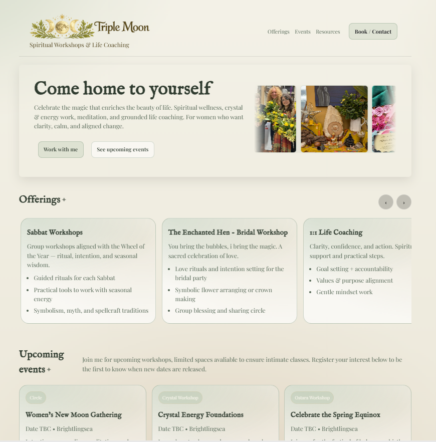

# Triple Moon

**Come home to yourself.**

A website for Triple Moon, a spiritual-wellness practice in Colchester, Essex, offering seasonal workshops, crystal healing, Reiki Seichem and life coaching. I led the full creative direction (identity, layout and UX) and built it as a responsive React site.

**[triplemoon.co.uk →](https://triplemoon.co.uk)**



## What's on the site

- **Services and workshops**: coaching, Sabbat workshops following the Wheel of the Year, crystal workshops, energy and crystal support, and more, each on its own page.
- **Resource library**: a searchable guide to over 200 crystals, herbs, flowers, trees and spices, filterable by type, element and intention.
- **Gallery and Instagram**: a photo gallery plus featured Instagram posts.
- **Contact form**: booking enquiries sent through Formspree, with no backend to maintain.

## Built with

React 19 (Create React App), React Router, plain CSS and Formspree. Hosted on Netlify with a custom domain.

## SEO for a single-page app

A React app normally serves the same empty HTML for every URL, so search engines and link previews that don't run JavaScript see nothing useful. This site fixes that without a framework:

- **Prerendered page heads.** After the build, [`scripts/prerender-head.js`](scripts/prerender-head.js) writes a static HTML file for each route, with that page's title, description, canonical URL and social tags already in the `<head>`. Netlify then serves `build/coaching.html` at `/coaching`, and so on.
- **One source of truth.** Page titles and descriptions live in [`src/seo/pages.json`](src/seo/pages.json), shared by the prerender script and the in-app `<Seo>` component.
- **Clean, canonical URLs.** [`netlify.toml`](netlify.toml) 301-redirects `http://`, `www.` and the old `.netlify.app` address to `https://triplemoon.co.uk`, and serves a `sitemap.xml` and `robots.txt`.

## Run locally

```bash
npm install
npm start        # http://localhost:3000
npm run build    # production build in build/, then prerenders each page's <head>
```

## Structure

```
src/
  *.js          one component per page (Home, Coaching, SabbatWorkshops, Resources…)
  data/         resource library data
  seo/          page titles and descriptions (pages.json) and site settings
scripts/        prerender-head.js: per-page HTML heads after the build
api/            a small Express API for the resource library (experimental, not used by the live site)
public/         images, sitemap.xml, robots.txt
```

---

Designed and built by [Zoe Blighton](https://zoeblighton.com) for Triple Moon.
